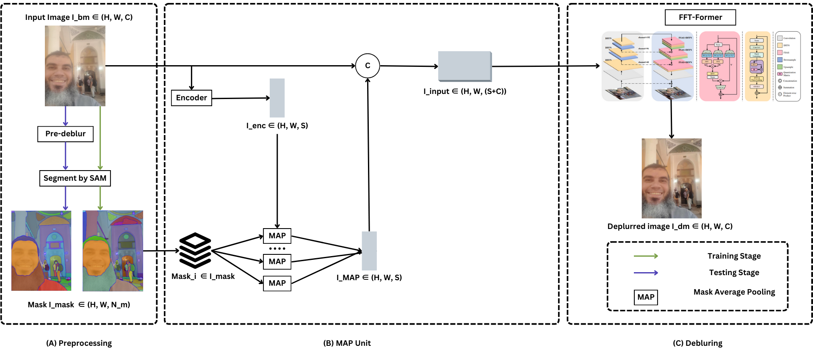

# Finding a Generalizable Image Deblurring Technique

**CSE779 Digital Image Processing — course project, M.Sc. Computer & Systems Engineering, Alexandria University (Spring 2024)**
Momen Ibrahim Fawzy · supervised by Dr. Marwan Torki and Dr. Hicham Elmongui

Deep deblurring models reach excellent scores on the dataset they were trained on and then degrade sharply on real
blur they have never seen. This project measures that gap for two state-of-the-art approaches and proposes a model
that combines their strengths:

| | Approach | Strength | Weakness |
|---|---|---|---|
| **FFTformer** (Kong et al., CVPR 2023) | Transformer that computes attention and feed-forward steps in the frequency domain | Best in-domain quality | Needs a checkpoint per blur domain |
| **SAM-Deblur** (Li et al., ICASSP 2024) | NAFNet conditioned on Segment-Anything masks through a *Mask Average Pooling* (MAP) unit | Generalises to unseen blur | Lower in-domain quality (NAFNet backbone) |
| **SAM-guided FFTformer** (this project) | FFTformer backbone inside the SAM-Deblur framework | Aims for both | Needs long fine-tuning |



*(A) SAM segments the image; at test time a pre-deblurring pass gives SAM cleaner boundaries. (B) An encoder maps the
blurry image to S feature channels, which are averaged inside every SAM mask (MAP). (C) The image and the MAP
features are concatenated (C + S channels) and restored by FFTformer.*

---

## Results

All numbers are PSNR (dB) / SSIM on the official test splits.

**1. FFTformer, official checkpoints, one per dataset** (measured in this project)

| GoPro | RealBlur-J | RealBlur-R |
|:---:|:---:|:---:|
| 34.10 / 0.968 | 32.20 / 0.931 | 40.10 / 0.972 |

High scores, but each column uses a checkpoint trained *on that dataset*.

**2. SAM-Deblur, trained on GoPro only**

| Method | GoPro (in-domain) | RealBlur-J (unseen) | ReLoBlur (unseen) |
|---|:---:|:---:|:---:|
| SAM-Deblur, reproduced here (1,111 GoPro test images) | **32.83 / 0.960** | – | – |
| NAFNet without SAM, reported by Li et al. | 32.85 / 0.960 | 26.57 / 0.866 | 25.26 / 0.687 |
| SAM-Deblur, reported by Li et al. | 32.83 / 0.960 | 26.62 / 0.867 | 32.29 / 0.903 |

The reproduction matches the published GoPro result exactly (32.8318 dB / 0.9603). The published cross-domain numbers
show the point of the SAM prior: almost no in-domain cost, and +7 dB on ReLoBlur, a blur type never seen in training.

**3. SAM-guided FFTformer.** During the course, SAM masks were generated for GoPro twice: once on the blurry images
and once on images deblurred by FFTformer. FFTformer's input stem was then extended to take the MAP features. The
first training run diverged because the learning rate was too high. After lowering it, an early checkpoint reached
**21.72 dB / 0.824** on GoPro (Milestone 3), and training was still in progress at the end of the course.

This repository re-implements the model more safely. The extra MAP channels go through an identity-initialised
projection, so training starts *exactly* from the pre-trained FFTformer (unit test
`test_initialisation_reproduces_backbone`) instead of from a partly re-initialised stem. Fine-tuning can then only
add the SAM prior on top of FFTformer's in-domain quality. A full fine-tuning run (100k iterations,
`configs/sam_fftformer_gopro.yaml`) followed by cross-domain evaluation is the next step.

**Findings**
- In-domain benchmarks hide the generalisation problem: a model must be judged on blur types it was not trained on.
- Segmentation priors are a cheap way to buy robustness: SAM's object boundaries survive blur better than texture.
- Unsupervised domain conversion (Blur2Blur, Pham et al., CVPR 2024) is the natural follow-up for real blur with no
  paired data. It was reviewed in the final milestone (see `docs/method.md`).

---

## Repository layout

```
src/deblur/
  data/datasets.py      GoPro / HIDE / RealBlur-J / RealBlur-R indexing and a paired dataset with aligned crops
  metrics.py            PSNR and SSIM (RGB or Y channel), per-image accumulation
  sam/masks.py          SAM automatic masks: generation, bit-packed storage, loading
  models/map_prior.py   Mask Average Pooling unit and mask dropout
  models/sam_guided.py  SAM-guided restorer (identity-initialised fusion) and plain baseline
  models/backbones.py   loads FFTformer / NAFNet from their official repositories without package clashes
  losses.py             L1 + frequency-domain L1
  engine.py             training loop (AdamW, cosine, AMP) and evaluation loop
scripts/
  setup_external.sh         clones the official FFTformer and SAM-Deblur code
  run_official_baselines.sh experiments 1 and 2
  generate_sam_masks.py     SAM masks per split (optionally on pre-deblurred images)
  train.py / evaluate.py    experiment 3
configs/sam_fftformer_gopro.yaml
docs/  datasets.md · method.md · timeline.md
tests/ unit tests (no GPU, data or external code needed)
```

## Quick start

```bash
pip install -e ".[sam,dev]"
bash scripts/setup_external.sh            # official FFTformer + SAM-Deblur code, SAM
# put datasets under data/ (docs/datasets.md) and checkpoints under weights/

bash scripts/run_official_baselines.sh    # experiments 1 and 2

python scripts/generate_sam_masks.py --dataset gopro --root data/GOPRO_Large --split train \
       --sam-checkpoint weights/sam_vit_b_01ec64.pth --out data/masks/gopro_train
python scripts/generate_sam_masks.py --dataset gopro --root data/GOPRO_Large --split test \
       --sam-checkpoint weights/sam_vit_b_01ec64.pth --pre-deblur weights/fftformer_GoPro.pth \
       --out data/masks/gopro_test
python scripts/train.py --config configs/sam_fftformer_gopro.yaml
python scripts/evaluate.py --model sam_fftformer --ckpt runs/sam_fftformer_gopro/best.pth \
       --dataset realblur_j --root data/RealBlur --masks data/masks/realblur_j_test

python -m pytest tests                    # 10 unit tests
```

## References
- L. Kong, J. Dong, J. Ge, M. Li, J. Pan. *Efficient Frequency Domain-based Transformers for High-Quality Image Deblurring.* CVPR 2023.
- S. Li, M. Liu, Y. Zhang, S. Chen, H. Li, Z. Dou, H. Chen. *SAM-Deblur: Let Segment Anything Boost Image Deblurring.* ICASSP 2024.
- A. Kirillov et al. *Segment Anything.* ICCV 2023.
- B.-D. Pham, P. Tran, A. Tran, C. Pham, R. Nguyen, M. Hoai. *Blur2Blur: Blur Conversion for Unsupervised Image Deblurring on Unknown Domains.* CVPR 2024.
- K. Zhang et al. *Deep Image Deblurring: A Survey.* IJCV 2022.
- Datasets: GoPro (Nah et al., CVPR 2017), HIDE (Shen et al., ICCV 2019), RealBlur (Rim et al., ECCV 2020), ReLoBlur (Li et al., AAAI 2023).

The official FFTformer, SAM-Deblur and Segment-Anything code is used through `external/` under its own licences and
is not redistributed here. The code in this repository is released under the MIT licence.
